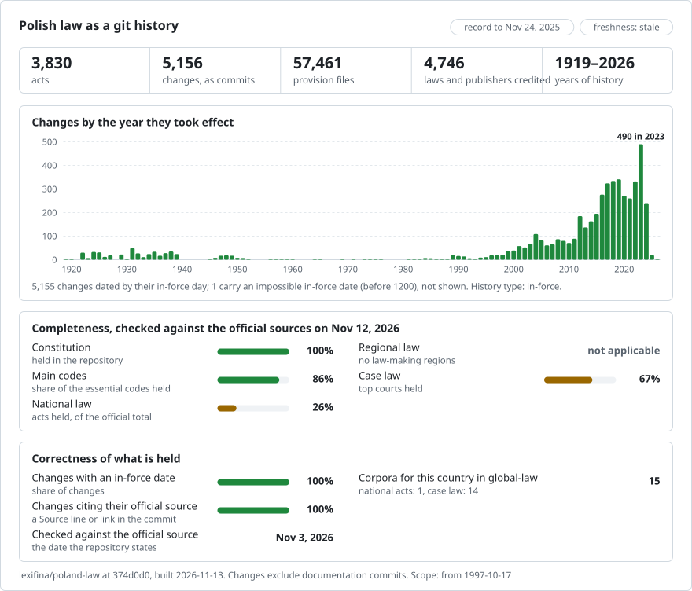

# Poland: law history in git

**English** · **[Lub przeczytaj po polsku](README.md)**

<picture>
<source media="(prefers-color-scheme: dark)" srcset="data/effort-dark.svg">

</picture>

The law of Poland as a git history: one file per article (per paragraph, §, in a regulation), one commit per version on the day it took effect, and the act that made each change as the commit's author. `git blame` names the act behind every article; `git log` lists every change to an article; picking a date gives the text in force that day.

Part of [lexifina/global-law](https://github.com/lexifina/global-law), one git history for every country's law: this is Poland's national law, which global-law reads at `poland/national/acts/`.

**What is in it now:** the Constitution, the Polish Citizenship Act, six codes (civil, civil procedure, criminal, criminal procedure, labour and commercial companies) and the Tax Ordinance, with their history of amendments in 1,049 versions; and the current text of 1,600 other acts (ustawy) and 2,226 regulations (rozporządzenia) in force, one version each. [`USTAWY.md`](USTAWY.md) and [`ROZPORZADZENIA.md`](ROZPORZADZENIA.md) say which acts and regulations in force are here and which were left out; `data/ustawy.csv` and `data/rozporzadzenia.csv` list them.

Each act is in `<kind>/<year>/<position>/`, from its first publication in the Dziennik Ustaw (`ustawa/1974/141/` is the Kodeks pracy, the Labour Code, Dz.U. 1974 nr 24 poz. 141). Until 10 November 2026 each folder was named by the act's id (`kodeks-pracy/`): `git log --follow` and `git blame` follow the move, `data/paths.json` maps each id to its folder, and the last two commands below name the old folder.

The text is in Polish, as the Sejm's API publishes it. An English translation is not part of this record.

## Questions as git commands

| Question | Command |
| --- | --- |
| Every change to Article 154 of the Labour Code | `git log --follow -p --word-diff -- ustawa/1974/141/art-154.md` |
| Which act wrote each line of Article 154? | `git blame ustawa/1974/141/art-154.md` |
| Every version of the Labour Code, with the day each took effect | `git log --format="%h %(trailers:key=In-force,valueonly,separator=) %an" -- ustawa/1974/141 kodeks-pracy` |
| Article 154 as in force on 1 January 2015 | `python tools/na_dzien.py 2015-01-01 kodeks-pracy 154` |

**Outside git**, we also host this record publicly, for free:

- **[Ask Claude about Polish law](https://global-law.lexifina.com/v1/try_claude?country=poland)**: opens Claude with a first question ready.
- **[Ask ChatGPT](https://global-law.lexifina.com/v1/try_chatgpt?country=poland)**: the same question in ChatGPT.
- **[Call the API in your browser](https://global-law.lexifina.com/v1/search_law?query=urlop+wypoczynkowy&jurisdictions=poland)**: a search of Polish law for "urlop wypoczynkowy", returned as JSON. See the [documentation here](https://lexifina.com/api/global-law).

Both assistants read the record through the free Global law connector (MCP, `https://global-law.lexifina.com/mcp`); the first time, the chat gives you the link that adds it. Ask in Polish or in English.

**Host it yourself easily.** All it takes is git and Python, and the tools run on your machine:

```sh
git clone --depth 1 https://github.com/lexifina/global-law && cd global-law
python3 tools/countries.py add poland/national/acts
python3 tools/law.py show 2026-01-01 poland/national/acts/ustawa/1974/141/art-154.md
```

Opened in Claude Code, Cursor, VS Code or Codex, the clone also starts a local MCP server with the same tools ([MCP.md](https://github.com/lexifina/global-law/blob/main/MCP.md)).

## Dates

Each commit is dated at noon, Europe/Warsaw, on the day the version took effect, and carries it in its `In-force:` trailer:

- for an amendment of an act with history, the day the Sejm's API gives for that amendment of this act, compared with the day the unified text's footnote gives; where the amending act as a whole took effect on another day, that day is in `Act-in-force:`;
- for an act or regulation held as its current text, the day the newest amendment in its newest unified text took effect (amendments in force later are listed in `Not-included:`), or, if it was never amended, the day it took effect;
- git cannot store dates before 1970, so the 507 earlier commits are dated from 1970-01-01, one second apart, with the real day in `In-force:`. Ask for a date with `tools/na_dzien.py`, not `git log --before`.

Each change is credited to the act or Constitutional Tribunal judgment that made it (`Dz.U. 2003 nr 213 poz. 2081`), as the unified texts' footnotes name it; the unified texts' own editorial changes, and an act held as the text of its newest unified text, are credited to the Marshal of the Sejm or the body that announced that text. A change no footnote explains is dated the unified text's day and credited to `Kancelaria Sejmu (ISAP)`, with the acts that took effect in between as `Candidate:` trailers (56 commits).

## How it is checked

- `tools/check_repo.py` reads each checkpoint of the acts with history (the act as published, every unified text, the Constitution's consolidated text) back from git on its day and compares it file by file, and word for word, with the official text.
- On each unified text's day, the history may differ from it only by that text's editorial changes (Journal references, provisions printed as "(pominięty)").
- `tools/test_repo.py` checks that blame, `git log --follow` and `tools/na_dzien.py` work. [`REPRODUCE.md`](REPRODUCE.md) records the build (the same data gives the same hashes) and its notes, such as lines where the history and a unified text differ.
- History is append-only since 2026-11-02: new acts and corrections go on top of `main`, and nothing published is rewritten.

## What it does not show

- **The codes' newest amendments.** Each code's history, and the Tax Ordinance's, ends at its last unified text published as HTML (the Labour Code's, in force on 2023-07-31); amendments in force after it are not in the record yet.
- **The earlier history of the 1,600 acts and 2,226 regulations** held as their current text.
- **Acts left out:** amending acts, acts amended but never consolidated, texts the API has only as PDF, and texts with tables, formulas or annexes the parser does not read yet (see `USTAWY.md`).
- **Case law, local law, Monitor Polski, EU law and bills.**
- **Which act made some changes.** 56 commits are credited to `Kancelaria Sejmu (ISAP)`, naming the candidate acts.

## Sources

| Source | Kind | Past versions | Notes |
| --- | --- | --- | --- |
| [ELI API of the Sejm](https://api.sejm.gov.pl/eli) (Kancelaria Sejmu) | Dziennik Ustaw: acts as published, unified texts, amending acts | for the acts with history, every unified text published as HTML; for the others, the newest | Unified and consolidated texts are for information; the legally binding text is the act as published in the Dziennik Ustaw |

## Licence

See [`LICENSE`](LICENSE). Normative acts and official documents are not protected by copyright in Poland (ustawa z dnia 4 lutego 1994 r. o prawie autorskim i prawach pokrewnych, art. 4 pkt 1 and 2). The history, commit messages, tables and tools are CC0 1.0.

No AI model wrote or changed legal text; the scripts were written by an AI model (see [`REPRODUCE.md`](REPRODUCE.md)).

## More

From [lexifina/global-law](https://github.com/lexifina/global-law):

- [FEATURES.md](https://github.com/lexifina/global-law/blob/main/FEATURES.md): every feature, and what every corpus must support (`git blame`, `law.py`, the MCP tools)
- [FAQ.md](https://github.com/lexifina/global-law/blob/main/FAQ.md): questions and answers · [CONTRIBUTING.md](https://github.com/lexifina/global-law/blob/main/CONTRIBUTING.md): proposing changes · [MCP.md](https://github.com/lexifina/global-law/blob/main/MCP.md): the MCP server · [REPRODUCE.md](https://github.com/lexifina/global-law/blob/main/REPRODUCE.md): how it was built · [CHANGELOG.md](https://github.com/lexifina/global-law/blob/main/CHANGELOG.md)
- [FRESHNESS.md](https://github.com/lexifina/global-law/blob/main/FRESHNESS.md): how current each corpus is · [Monitoring](https://github.com/lexifina/global-law/tree/main/monitoring): whether updates are running · [WATCHING.md](https://github.com/lexifina/global-law/blob/main/WATCHING.md): how each official source is watched for changes
- [performance/](https://github.com/lexifina/global-law/tree/main/performance): how fast the tools are, measured
- [visualisations/](https://github.com/lexifina/global-law/tree/main/visualisations): charts and bridges across the world's law
- [Vulnerabilities](https://github.com/lexifina/global-law/tree/main/vulnerabilities): mistakes in legislation as published
