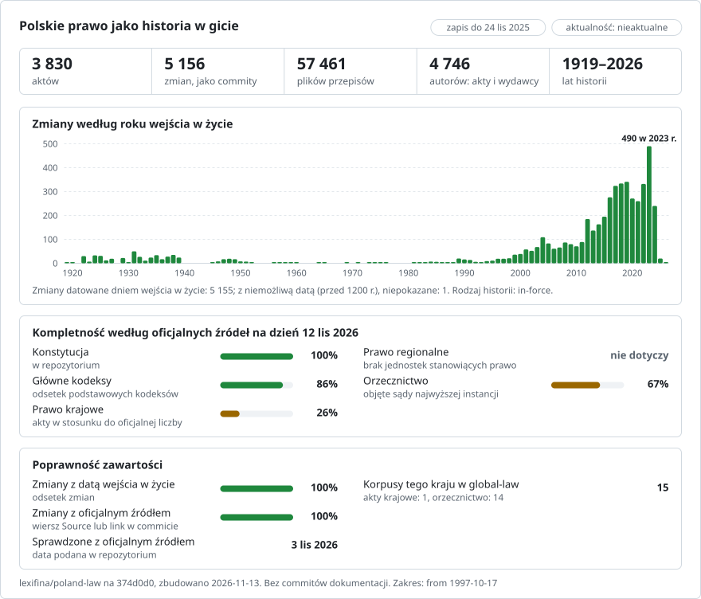

# Polska: historia prawa w gicie

**Polski** · **[Or read it in English](README.en.md)**

<picture>
<source media="(prefers-color-scheme: dark)" srcset="data/pl/effort-dark.svg">

</picture>

Prawo Polski jako historia git: jeden plik na artykuł (w rozporządzeniu na paragraf, §), jeden commit na każdą wersję w dniu, w którym weszła w życie, a jako autor commita akt, który wprowadził zmianę. `git blame` wskazuje akt stojący za każdym artykułem; `git log` wymienia każdą zmianę artykułu; wybrana data daje tekst obowiązujący tego dnia.

Część projektu [lexifina/global-law](https://github.com/lexifina/global-law), jednej historii git prawa wszystkich państw: to jest prawo krajowe Polski, które global-law odczytuje ze ścieżki `poland/national/acts/`.

**Co zawiera teraz:** Konstytucję, ustawę o obywatelstwie polskim, sześć kodeksów (cywilny, postępowania cywilnego, karny, postępowania karnego, pracy i spółek handlowych) oraz Ordynację podatkową, z historią zmian w 1049 wersjach; a także aktualny tekst 1600 innych obowiązujących ustaw i 2226 obowiązujących rozporządzeń, po jednej wersji. [`USTAWY.md`](USTAWY.md) i [`ROZPORZADZENIA.md`](ROZPORZADZENIA.md) wyjaśniają, które obowiązujące ustawy i rozporządzenia tu są, a które pominięto; wymieniają je `data/ustawy.csv` i `data/rozporzadzenia.csv`.

Każdy akt jest w `<rodzaj>/<rok>/<pozycja>/`, według pierwszego ogłoszenia w Dzienniku Ustaw (`ustawa/1974/141/` to Kodeks pracy, Dz.U. 1974 nr 24 poz. 141). Do 10 listopada 2026 r. folder nosił nazwę identyfikatora aktu (`kodeks-pracy/`): `git log --follow` i `git blame` śledzą to przeniesienie, `data/paths.json` przypisuje każdemu identyfikatorowi jego folder, a dwa ostatnie polecenia poniżej podają dawny folder.

Tekst jest po polsku, tak jak publikuje go API Sejmu. Tłumaczenie na angielski nie jest częścią tego zapisu.

## Pytania jako polecenia git

| Pytanie | Polecenie |
| --- | --- |
| Każda zmiana art. 154 Kodeksu pracy | `git log --follow -p --word-diff -- ustawa/1974/141/art-154.md` |
| Który akt napisał każdy wiersz art. 154? | `git blame ustawa/1974/141/art-154.md` |
| Każda wersja Kodeksu pracy, z dniem wejścia w życie | `git log --format="%h %(trailers:key=In-force,valueonly,separator=) %an" -- ustawa/1974/141 kodeks-pracy` |
| Art. 154 w brzmieniu obowiązującym 1 stycznia 2015 r. | `python tools/na_dzien.py 2015-01-01 kodeks-pracy 154` |

**Poza gitem** udostępniamy ten zapis także publicznie i bezpłatnie:

- **[Zapytaj Claude'a o prawo polskie](https://global-law.lexifina.com/v1/try_claude?country=poland)**: otwiera Claude'a z gotowym pierwszym pytaniem.
- **[Zapytaj ChatGPT](https://global-law.lexifina.com/v1/try_chatgpt?country=poland)**: to samo pytanie w ChatGPT.
- **[Wywołaj API w przeglądarce](https://global-law.lexifina.com/v1/search_law?query=urlop+wypoczynkowy&jurisdictions=poland)**: wyszukiwanie „urlop wypoczynkowy” w prawie polskim, odpowiedź w JSON. Dokumentacja jest [tutaj](https://lexifina.com/api/global-law).

Obaj asystenci czytają zapis przez bezpłatny konektor Global law (MCP, `https://global-law.lexifina.com/mcp`); za pierwszym razem czat poda link, który go dodaje. Pytaj po polsku albo po angielsku.

**Łatwo uruchomisz go sam.** Wystarczą git i Python, a narzędzia działają na Twoim komputerze:

```sh
git clone --depth 1 https://github.com/lexifina/global-law && cd global-law
python3 tools/countries.py add poland/national/acts
python3 tools/law.py show 2026-01-01 poland/national/acts/ustawa/1974/141/art-154.md
```

Otwarty w Claude Code, Cursorze, VS Code lub Codexie klon uruchamia też lokalny serwer MCP z tymi samymi narzędziami ([MCP.md](https://github.com/lexifina/global-law/blob/main/MCP.md)).

## Daty

Każdy commit ma datę w południe czasu warszawskiego (Europe/Warsaw) w dniu, w którym wersja weszła w życie, a ten dzień podaje też jego trailer `In-force:`:

- dla zmiany aktu z historią: dzień, który API Sejmu podaje dla tej zmiany tego aktu, porównany z dniem z przypisu tekstu jednolitego; jeżeli akt zmieniający jako całość wszedł w życie innego dnia, ten dzień jest w `Act-in-force:`;
- dla ustawy lub rozporządzenia w aktualnym tekście: dzień wejścia w życie najnowszej zmiany ujętej w najnowszym tekście jednolitym (zmiany, które weszły w życie później, wymienia `Not-included:`), a dla aktu nigdy niezmienianego dzień jego wejścia w życie;
- git nie zapisuje dat sprzed 1970 r., więc 507 wcześniejszych commitów ma daty od 1970-01-01, w odstępach jednej sekundy, a prawdziwy dzień jest w `In-force:`. O datę pytaj narzędziem `tools/na_dzien.py`, nie `git log --before`.

Każda zmiana jest przypisana aktowi lub wyrokowi Trybunału Konstytucyjnego, który ją wprowadził (`Dz.U. 2003 nr 213 poz. 2081`), tak jak wskazują go przypisy tekstów jednolitych; własne zmiany redakcyjne tekstów jednolitych oraz akt w brzmieniu najnowszego tekstu jednolitego są przypisane Marszałkowi Sejmu albo organowi, który ten tekst ogłosił. Zmiana, której nie wyjaśnia żaden przypis, ma datę tekstu jednolitego i jest przypisana `Kancelaria Sejmu (ISAP)`, a akty, które weszły w życie w tym okresie, podają trailery `Candidate:` (56 commitów).

## Jak jest sprawdzane

- `tools/check_repo.py` odczytuje z gita każdy punkt kontrolny aktów z historią (akt w brzmieniu ogłoszonym, każdy tekst jednolity, tekst ujednolicony Konstytucji) w jego dniu i porównuje go z tekstem urzędowym plik po pliku oraz słowo po słowie.
- W dniu każdego tekstu jednolitego historia może się od niego różnić tylko zmianami redakcyjnymi tego tekstu (odesłania do Dziennika Ustaw, przepisy wydrukowane jako „(pominięty)”).
- `tools/test_repo.py` sprawdza, czy działają blame, `git log --follow` i `tools/na_dzien.py`. [`REPRODUCE.md`](REPRODUCE.md) opisuje budowę (te same dane dają te same hashe) i jej uwagi, np. wiersze, w których historia różni się od tekstu jednolitego.
- Od 2026-11-02 historia jest tylko dopisywana: nowe akty i korekty trafiają na wierzch `main`, a nic opublikowanego nie jest przepisywane.

## Czego nie pokazuje

- **Najnowszych zmian kodeksów.** Historia każdego kodeksu i Ordynacji podatkowej kończy się na ostatnim tekście jednolitym opublikowanym w HTML (w Kodeksie pracy: tekst jednolity obowiązujący od 2023-07-31); zmian, które weszły w życie później, jeszcze tu nie ma.
- **Wcześniejszej historii 1600 ustaw i 2226 rozporządzeń** przechowywanych w aktualnym tekście.
- **Pominiętych aktów:** ustaw zmieniających, aktów zmienionych bez tekstu jednolitego, tekstów, które API ma tylko w PDF, oraz tekstów z tabelami, wzorami lub załącznikami, których parser jeszcze nie czyta (zob. `USTAWY.md`).
- **Orzecznictwa, prawa miejscowego, Monitora Polskiego, prawa UE ani projektów ustaw.**
- **Który akt wprowadził niektóre zmiany.** 56 commitów jest przypisanych `Kancelaria Sejmu (ISAP)`, ze wskazaniem aktów, które mogły je wprowadzić.

## Źródła

| Źródło | Rodzaj | Wcześniejsze wersje | Uwagi |
| --- | --- | --- | --- |
| [API ELI Sejmu](https://api.sejm.gov.pl/eli) (Kancelaria Sejmu) | Dziennik Ustaw: akty w brzmieniu ogłoszonym, teksty jednolite, akty zmieniające | dla aktów z historią każdy tekst jednolity opublikowany w HTML; dla pozostałych najnowszy | Teksty jednolite i ujednolicone mają charakter informacyjny; tekstem prawnie wiążącym jest akt w brzmieniu ogłoszonym w Dzienniku Ustaw |

## Licencja

Zob. [`LICENSE`](LICENSE). Akty normatywne i dokumenty urzędowe nie są w Polsce przedmiotem prawa autorskiego (ustawa z dnia 4 lutego 1994 r. o prawie autorskim i prawach pokrewnych, art. 4 pkt 1 i 2). Historia, opisy commitów, tabele i narzędzia są udostępnione na licencji CC0 1.0.

Żaden model AI nie napisał ani nie zmienił tekstu prawnego; skrypty napisał model AI (zob. [`REPRODUCE.md`](REPRODUCE.md)).

To jest tłumaczenie wersji angielskiej ([README.en.md](README.en.md)); w razie rozbieżności rozstrzyga wersja angielska.

## Więcej

Z repozytorium [lexifina/global-law](https://github.com/lexifina/global-law) (po angielsku):

- [FEATURES.md](https://github.com/lexifina/global-law/blob/main/FEATURES.md): wszystkie funkcje i to, co musi obsługiwać każdy korpus (`git blame`, `law.py`, narzędzia MCP)
- [FAQ.md](https://github.com/lexifina/global-law/blob/main/FAQ.md): pytania i odpowiedzi · [CONTRIBUTING.md](https://github.com/lexifina/global-law/blob/main/CONTRIBUTING.md): proponowanie zmian · [MCP.md](https://github.com/lexifina/global-law/blob/main/MCP.md): serwer MCP · [REPRODUCE.md](https://github.com/lexifina/global-law/blob/main/REPRODUCE.md): jak powstał · [CHANGELOG.md](https://github.com/lexifina/global-law/blob/main/CHANGELOG.md)
- [FRESHNESS.md](https://github.com/lexifina/global-law/blob/main/FRESHNESS.md): jak aktualny jest każdy korpus · [Monitorowanie](https://github.com/lexifina/global-law/tree/main/monitoring): czy aktualizacje działają · [WATCHING.md](https://github.com/lexifina/global-law/blob/main/WATCHING.md): jak każde oficjalne źródło jest obserwowane pod kątem zmian
- [performance/](https://github.com/lexifina/global-law/tree/main/performance): jak szybkie są narzędzia, zmierzone
- [visualisations/](https://github.com/lexifina/global-law/tree/main/visualisations): wykresy i powiązania w prawie całego świata
- [Podatności](https://github.com/lexifina/global-law/tree/main/vulnerabilities): błędy w przepisach w opublikowanej postaci
