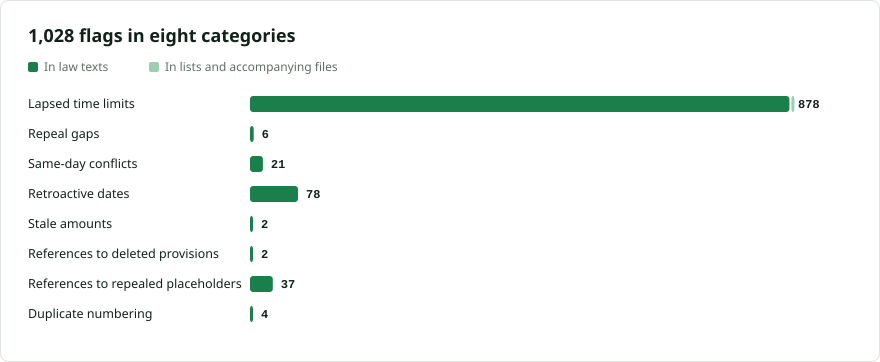

# Vulnerabilities in Polish law

[Polski](README.md) · **English**

<picture>
<source media="(prefers-color-scheme: dark)" srcset="img/flags-by-category-dark.svg">

</picture>

The vulnerability detectors from [lexifina/global-law](https://github.com/lexifina/global-law/tree/main/vulnerabilities) look for mechanical mistakes in legislation: a rule applying "until" a date that has passed, a time limit extended only after it had run out, two amendments to the same provision on the same day, an act in force before it was published, a reference to an article that no longer exists or now reads only "(uchylony)". global-law's published list (9 November 2026) has no flags for Poland, so this is a run over this repository only, as it stood at commit [`1222e3e`](https://github.com/lexifina/poland-law/commit/1222e3e319c1119d94bfa4bb149e31bc83bff7dd) on 16 November 2026: the Constitution, 3,181 acts (ustawy, the codes among them) and 2,228 regulations (rozporządzenia) with their text, and 56,263 records of other acts, the Monitor Polski's among them, that hold only the ELI metadata, with no text to read.

**In short:** the detectors raised 1,028 flags. A language model reviewed 116 of the strongest, arguing each one for and against; 18 survived. Checked by hand in this repository and against the acts as published, none of the 18 is a mistake in Polish law: 13 are lawful, 10 of them acts that state their own retroactive commencement, 2 are spent one-off deadlines, 2 come from how this repository's record is built, and 1 is the same amount in two unrelated acts. Reading the category the model does not review turned up one likely drafting mistake: Act of 30 August 2019 (Dz.U. 2019 poz. 1798) repealed art. 341 of the Commercial Companies Code (the share register book, księga akcyjna) and, in the same article, gave the fine in art. 594 § 1 pkt 2 a new wording that still punishes a management board member who "does not keep the share register book in accordance with art. 341 § 1". Later, this will be formalised in Lean, similar to our work on [the US tax code](https://lexifina.com/blog/formalizing-the-us-tax-code) and [US case law](https://lexifina.com/blog/formalizing-all-us-case-law-in-lean).

A flag is a prompt to look, not legal advice, and nothing here has been tested in court.

## Flags by category

| Category | What it looks for | Flags | In law texts | Reviewed | Survived review |
| --- | --- | ---: | ---: | ---: | ---: |
| Lapsed time limits | Text still applying a rule "until" a date that has passed | 878 | 877 | 45 | 3 |
| Repeal gaps | A provision removed before its replacement took effect | 6 | 6 | 6 | 0 |
| Same-day conflicts | Two acts changing the same provision with the same in-force day | 21 | 21 | 21 | 3 |
| Retroactive dates | An act in force before it was published | 78 | 78 | 40 | 11 |
| Stale amounts | An amount changed in one place but still standing elsewhere | 2 | 2 | 2 | 1 |
| References to deleted provisions | A provision citing an article that no longer exists | 2 | 2 | 2 | 0 |
| References to repealed placeholders | A provision citing an article that now reads only "(uchylony)" | 37 | 37 | 0 | 0 |
| Duplicate numbering | Two units with the same number in one provision | 4 | 4 | 0 | 0 |

"In law texts" counts every file of the Constitution, the acts, the regulations and the one notice (obwieszczenie) with text. The one flag outside them is in this repository's English README ("Until 10 November 2026 each folder was named ..."). All but nine acts here are one version each, as published or as their newest unified text (tekst jednolity), so the history detectors (repeal gaps, same-day conflicts, references to deleted provisions) see changes only in the Constitution, the six codes, the Tax Ordinance and the citizenship act, which have a history; a retroactive date is read from an act's first version, whose day of entry into force comes, for most acts, from the official ELI metadata. The search for lapsed time limits reads "do dnia 31 grudnia 2020 r.", "do 31 grudnia 2020 r." and, since this run, the end of a year ("do końca 2035 r.", "do końca roku 1922": 40 phrases in law texts, past or future); deadlines ("najpóźniej do" and "nie później niż do", 84 of the flags) are read too, but since this run they rank lower, as "nejpozději" does in Czech, and the search for empty periods leaves them out. It still leaves out phrases that give only a month or a year: 8 "do (końca) <month> <year>" and 13 "do <year> r." in law texts, past or future. No dead currencies were found: no text here writes "starych złotych", the pre-1995 złoty, and amounts in "zł" are not dated by the detector. The search for empty periods found none.

*Edge cases: the 18 flags that survived the review, grouped by what they turned out to be, the likely mistake found by reading, and what the other flags are, in [EDGE-CASES.en.md](EDGE-CASES.en.md).*

## Problems found in this repository

- **Changes credited to the wrong act:** the commit [`0dbe114`](https://github.com/lexifina/poland-law/commit/0dbe114d541e1b1f86c2be90b5584c53007467e8) credits changes to six articles of the Tax Ordinance (art. 13, 15, 108, 144b, 181a and 299) on 1 January 2016 to Dz.U. 2016 poz. 1948, the act introducing the National Revenue Administration, which took effect on 1 March 2017. Its evidence is the unified text's footnotes, "added by art. 45 ... of the act referred to in note 7; in force on 1 January 2016". Art. 45 of Dz.U. 2016 poz. 1948 amends the pensions act; art. 45 of Dz.U. 2015 poz. 1269 (the Act on Tax Administration) amends the Tax Ordinance and, in pkt 18, added art. 299 § 3 pkt 8a and 8b. In the record, the commit of Dz.U. 2015 poz. 1269 for the same day ([`0ef03e7`](https://github.com/lexifina/poland-law/commit/0ef03e7a02cd8a932abea3907af4becf91acbcf2)) adds pkt 8b cut off mid-word ("jako organ egzeku"), and the commit credited to Dz.U. 2016 poz. 1948 completes it, so `git blame` gives the end of pkt 8b to the wrong act (one of the same-day conflicts, in [Edge cases](EDGE-CASES.en.md)).
- **An in-force day that contradicts the act:** for the Act of 18 March 1932 on an additional credit for 1931/32 (Dz.U. 1932 nr 25 poz. 224) the record takes the day of entry into force from the ELI metadata, 30 April 1930; the act's own [art. 4](https://github.com/lexifina/poland-law/blob/1222e3e319c1119d94bfa4bb149e31bc83bff7dd/ustawa/1932/224/art-004.md) says it enters into force on publication "with effect from 1 April 1931".

## Files

| File | What it holds |
| --- | --- |
| [data/flags.csv](data/flags.csv) | Every flag, one row per provision and issue |
| [data/reviewed.csv](data/reviewed.csv) | The 116 flags the model reviewed, with its verdict and reason |
| [data/by_category.csv](data/by_category.csv) | The counts in the table above |
| [tools/](tools/) | The scripts that made this run |

Columns: `category` and `category_pl` (the category in English and Polish), `detector`, `kind` (`law` or `other`), `path` (the provision in this repository), `date` (the date the flag turns on), `reference` (the act or line involved), `summary`, `score` (the detector's ranking, 0 to 1), `review` (`artefact`, `lawful` or `candidate_defect`), `survives_rebuttal`, `review_note` (the model's reason, in English), `url` (the provision at the commit that was read, or, for a provision removed since, at the last commit that held it).

## How it was made

- **Detectors:** global-law's [vulnerabilities/scripts](https://github.com/lexifina/global-law/tree/main/vulnerabilities/scripts), with the fixes in [tools/patch_detectors.py](tools/patch_detectors.py) and the Polish ones in [tools/patch_pl.py](tools/patch_pl.py), run on this repository at commit `1222e3e`. The history table the detectors read was built from this repository's own commits (the act that made each change and the `In-force` trailer), with acts as published (`Kind: Ustawa`, `Rozporządzenie`, `Obwieszczenie`), current texts, Constitutional Tribunal rulings and the correction of printing errors counted as law; editorial changes of unified texts, corrections of the record, documentation and the metadata-only records keep their own kind. The Polish fixes read "nie później niż" as a deadline and "do końca <year>" as 31 December; read "§" inside an article of a code as a paragraph of that article, "art. 4¹" as article 4¹ and "art. 47o" as article 47o; leave out a reference followed by another act's name ("art. 8 Kodeksu cywilnego", "art. 7 ust. 2 ustawy z dnia ...") and the chapter headings "(zawierający art. 62-70 - uchylony)"; and count as a placeholder only a provision that reads "(uchylony)" as a whole. Without them the run gave 139 references to deleted provisions, 195 references to repealed placeholders and 246 duplicate numbers; with them 2, 37 and 4.
- **Model review:** gpt-5.4-mini, the 40 strongest flags per category (all of them where there were fewer); the 40 strongest lapsed time limits in law texts are the same 40. After Polish deadlines were ranked lower, the 5 lapsed time limits new among the 40 strongest were reviewed too, keeping the reviews already made (45 in all). One pass says whether a flag is real, a second argues that it is not. The model does not review references to repealed placeholders or duplicate numbering. global-law's own list used a different model.
- **Hand check:** every flag that survived was read in this repository's texts and history, and for the retroactive dates and the same-day conflicts against the commencement article or the amending act's own text; where this repository does not hold the amending act (Dz.U. 2001 nr 99 poz. 1075, Dz.U. 2015 poz. 1269, Dz.U. 2016 poz. 1948, Dz.U. 2019 poz. 1798), its text was read in the Sejm's ELI API. All 37 references to repealed placeholders and the 4 duplicate numbers were read.

To report a correction, open an issue with the provision and an official source.

## Licence

The lists and notes are Lexifina's, dedicated to the public domain under CC0 1.0 like the rest of this repository's own contributions. Quoted law text is as the Sejm's ELI API publishes it; normative acts and official documents are not protected by copyright in Poland (Act of 4 February 1994 on Copyright and Related Rights, art. 4 pkt 1 and 2), and the legally binding text is the act as published in the Dziennik Ustaw. See [LICENSE](../LICENSE).
