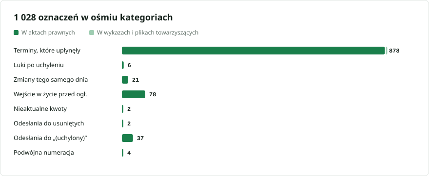

# Podatności w prawie polskim

**Polski** · [English](README.en.md)

<picture>
<source media="(prefers-color-scheme: dark)" srcset="img/flags-by-category-dark.pl.svg">

</picture>

Detektory podatności z repozytorium [lexifina/global-law](https://github.com/lexifina/global-law/tree/main/vulnerabilities) wyszukują mechaniczne błędy w przepisach: regułę, która nadal obowiązuje „do” dnia, który już minął, termin przedłużony dopiero po jego upływie, dwie zmiany tego samego przepisu wchodzące w życie tego samego dnia, akt obowiązujący przed jego ogłoszeniem, odesłanie do artykułu, którego już nie ma albo który brzmi już tylko „(uchylony)”. Lista opublikowana przez global-law 9 listopada 2026 r. nie zawiera oznaczeń dla Polski. Jest to więc przegląd wyłącznie tego repozytorium, w stanie z commitu [`1222e3e`](https://github.com/lexifina/poland-law/commit/1222e3e319c1119d94bfa4bb149e31bc83bff7dd) z 16 listopada 2026 r.: Konstytucji, 3 181 ustaw (w tym kodeksów) i 2 228 rozporządzeń wraz z ich tekstem oraz 56 263 rekordów innych aktów, także z Monitora Polskiego, które zawierają tylko metadane ELI, bez tekstu do przeszukania.

**W skrócie:** detektory wygenerowały 1 028 oznaczeń. Model językowy ocenił 116 najsilniejszych, rozważając w każdym przypadku argumenty za i przeciw; 18 się utrzymało. Po ręcznym sprawdzeniu w tym repozytorium i w tekstach aktów w brzmieniu ogłoszonym żadne z tych 18 nie jest błędem w prawie polskim: 13 jest zgodnych z prawem, w tym 10 aktów, które same przewidują wsteczny dzień wejścia w życie, 2 to jednorazowe terminy, które się wyczerpały, 2 wynikają ze sposobu budowy zapisu tego repozytorium, a 1 to ta sama kwota w dwóch niezwiązanych aktach. Lektura kategorii, której model nie ocenia, ujawniła jeden prawdopodobny błąd legislacyjny: ustawa z dnia 30 sierpnia 2019 r. (Dz.U. 2019 poz. 1798) uchyliła art. 341 Kodeksu spółek handlowych (księgę akcyjną) i w tym samym artykule nadała przepisowi karnemu art. 594 § 1 pkt 2 nowe brzmienie, które nadal karze członka zarządu za to, że zarząd „nie prowadzi księgi akcyjnej zgodnie z art. 341 § 1”. W przyszłości zostanie to sformalizowane w Leanie, podobnie jak nasza praca nad [amerykańskim kodeksem podatkowym](https://lexifina.com/blog/formalizing-the-us-tax-code) i [orzecznictwem USA](https://lexifina.com/blog/formalizing-all-us-case-law-in-lean).

Oznaczenie jest sygnałem, by przyjrzeć się przepisowi, a nie poradą prawną, i nic z tego nie zostało zweryfikowane przez sąd.

## Oznaczenia według kategorii

| Kategoria | Czego szuka | Oznaczenia | W aktach prawnych | Ocenione | Utrzymane |
| --- | --- | ---: | ---: | ---: | ---: |
| Terminy, które upłynęły | Tekst, który nadal stosuje regułę „do” dnia, który już minął | 878 | 877 | 45 | 3 |
| Luki po uchyleniu | Przepis usunięty, zanim weszło w życie to, co miało go zastąpić | 6 | 6 | 6 | 0 |
| Zmiany tego samego dnia | Dwa akty zmieniające ten sam przepis z tym samym dniem wejścia w życie | 21 | 21 | 21 | 3 |
| Wejście w życie przed ogłoszeniem | Akt obowiązujący przed jego ogłoszeniem | 78 | 78 | 40 | 11 |
| Nieaktualne kwoty | Kwota zmieniona w jednym miejscu, która w innym nadal widnieje | 2 | 2 | 2 | 1 |
| Odesłania do usuniętych przepisów | Przepis odsyłający do artykułu, którego już nie ma | 2 | 2 | 2 | 0 |
| Odesłania do przepisów „(uchylony)” | Przepis odsyłający do artykułu, który brzmi już tylko „(uchylony)” | 37 | 37 | 0 | 0 |
| Podwójna numeracja | Dwie jednostki o tym samym numerze w jednym przepisie | 4 | 4 | 0 | 0 |

„W aktach prawnych” obejmuje każdy plik Konstytucji, ustaw, rozporządzeń i jedynego obwieszczenia z tekstem. Jedyne oznaczenie poza nimi znajduje się w angielskim README tego repozytorium („Until 10 November 2026 each folder was named ...”). Wszystkie akty poza dziewięcioma mają tu po jednej wersji, w brzmieniu ogłoszonym albo według najnowszego tekstu jednolitego, więc detektory historii (luki po uchyleniu, zmiany tego samego dnia, odesłania do usuniętych przepisów) widzą zmiany tylko w Konstytucji, sześciu kodeksach, Ordynacji podatkowej i ustawie o obywatelstwie polskim, które mają historię; wejście w życie przed ogłoszeniem jest odczytywane z pierwszej wersji aktu, której dzień wejścia w życie pochodzi w większości przypadków z urzędowych metadanych ELI. Wyszukiwanie terminów, które upłynęły, odczytuje „do dnia 31 grudnia 2020 r.”, „do 31 grudnia 2020 r.”, a od tego przeglądu także koniec roku („do końca 2035 r.”, „do końca roku 1922”: 40 takich wyrażeń w aktach prawnych, z datą minioną lub przyszłą); terminy zakreślone jako ostateczne („najpóźniej do” i „nie później niż do”, 84 oznaczenia) są również odczytywane, ale od tego przeglądu mają niższą pozycję, tak jak czeskie „nejpozději”, a wyszukiwanie przerw w obowiązywaniu je pomija. Nadal pomija wyrażenia podające tylko miesiąc albo rok: 8 typu „do (końca) <miesiąc> <rok>” i 13 typu „do <rok> r.” w aktach prawnych, z datą minioną lub przyszłą. Nie znaleziono wycofanych walut: żaden tekst nie posługuje się określeniem „starych złotych”, a kwot w „zł” detektor nie wiąże z datą. Wyszukiwanie przerw w obowiązywaniu nie znalazło żadnej.

*Przypadki graniczne: 18 oznaczeń, które utrzymały się po ocenie, pogrupowanych według tego, czym okazały się być, prawdopodobny błąd znaleziony podczas lektury oraz to, czym są pozostałe oznaczenia, w [EDGE-CASES.md](EDGE-CASES.md).*

## Problemy znalezione w tym repozytorium

- **Zmiany przypisane niewłaściwemu aktowi:** commit [`0dbe114`](https://github.com/lexifina/poland-law/commit/0dbe114d541e1b1f86c2be90b5584c53007467e8) przypisuje zmiany sześciu artykułów Ordynacji podatkowej (art. 13, 15, 108, 144b, 181a i 299) z dnia 1 stycznia 2016 r. ustawie Dz.U. 2016 poz. 1948 – Przepisy wprowadzające ustawę o Krajowej Administracji Skarbowej, która weszła w życie 1 marca 2017 r. Podstawą są przypisy tekstu jednolitego: „Dodany przez art. 45 ... ustawy, o której mowa w odnośniku 7; wszedł w życie z dniem 1 stycznia 2016 r.”. Art. 45 ustawy Dz.U. 2016 poz. 1948 zmienia ustawę o emeryturach i rentach z Funduszu Ubezpieczeń Społecznych; Ordynację podatkową zmienia art. 45 ustawy o administracji podatkowej (Dz.U. 2015 poz. 1269), który w pkt 18 dodał art. 299 § 3 pkt 8a i 8b. W zapisie commit tej ustawy z tego samego dnia ([`0ef03e7`](https://github.com/lexifina/poland-law/commit/0ef03e7a02cd8a932abea3907af4becf91acbcf2)) urywa pkt 8b w połowie słowa („jako organ egzeku”), a dokańcza go commit przypisany ustawie Dz.U. 2016 poz. 1948, więc `git blame` przypisuje koniec pkt 8b niewłaściwemu aktowi (jedna ze zmian tego samego dnia, w [przypadkach granicznych](EDGE-CASES.md)).
- **Dzień wejścia w życie sprzeczny z treścią aktu:** dla ustawy z dnia 18 marca 1932 r. o dodatkowym kredycie na rok 1931/32 (Dz.U. 1932 nr 25 poz. 224) zapis przyjmuje z metadanych ELI dzień wejścia w życie 30 kwietnia 1930 r., tymczasem [art. 4](https://github.com/lexifina/poland-law/blob/1222e3e319c1119d94bfa4bb149e31bc83bff7dd/ustawa/1932/224/art-004.md) tej ustawy stanowi, że wchodzi ona w życie z dniem ogłoszenia „z mocą obowiązującą od dniu 1 kwietnia 1931 r.”.

## Pliki

| Plik | Zawartość |
| --- | --- |
| [data/flags.csv](data/flags.csv) | Wszystkie oznaczenia, jeden wiersz na przepis i problem |
| [data/reviewed.csv](data/reviewed.csv) | 116 oznaczeń ocenionych przez model, z jego oceną i uzasadnieniem |
| [data/by_category.csv](data/by_category.csv) | Liczby z powyższej tabeli |
| [tools/](tools/) | Skrypty, którymi wykonano ten przegląd |

Kolumny: `category` i `category_pl` (kategoria po angielsku i po polsku), `detector`, `kind` (`law` albo `other`), `path` (przepis w tym repozytorium), `date` (data, której dotyczy oznaczenie), `reference` (akt lub wiersz, o który chodzi), `summary`, `score` (pozycja nadana przez detektor, od 0 do 1), `review` (`artefact`, `lawful` albo `candidate_defect`), `survives_rebuttal`, `review_note` (uzasadnienie modelu, po angielsku), `url` (przepis w odczytanym commicie albo, w przypadku przepisu usuniętego później, w ostatnim commicie, który go zawierał).

## Jak to powstało

- **Detektory:** skrypty [vulnerabilities/scripts](https://github.com/lexifina/global-law/tree/main/vulnerabilities/scripts) z global-law, z poprawkami z [tools/patch_detectors.py](tools/patch_detectors.py) i polskimi poprawkami z [tools/patch_pl.py](tools/patch_pl.py), uruchomione na tym repozytorium w commicie `1222e3e`. Tabelę historii, którą czytają detektory, zbudowano z własnych commitów tego repozytorium (akt, który wprowadził każdą zmianę, i trailer `In-force`); za prawo uznano akty w brzmieniu ogłoszonym (`Kind: Ustawa`, `Rozporządzenie`, `Obwieszczenie`), teksty aktualne, wyroki Trybunału Konstytucyjnego i sprostowanie błędów, natomiast redakcyjne zmiany tekstów jednolitych, korekty zapisu, dokumentacja i rekordy z samymi metadanymi zachowują własny rodzaj. Polskie poprawki odczytują „nie później niż” jako termin ostateczny, a „do końca <rok>” jako 31 grudnia; czytają „§” wewnątrz artykułu kodeksu jako paragraf tego artykułu, „art. 4¹” jako art. 4¹, a „art. 47o” jako art. 47o; pomijają odesłanie, po którym pada nazwa innego aktu („art. 8 Kodeksu cywilnego”, „art. 7 ust. 2 ustawy z dnia ...”), oraz nagłówki „(zawierający art. 62-70 - uchylony)”; za przepis „(uchylony)” uznają tylko przepis, który w całości brzmi „(uchylony)”. Bez nich przegląd dawał 139 odesłań do usuniętych przepisów, 195 odesłań do przepisów „(uchylony)” i 246 przypadków podwójnej numeracji; z nimi 2, 37 i 4.
- **Ocena modelu:** gpt-5.4-mini, 40 najsilniejszych oznaczeń w każdej kategorii (wszystkie, jeśli było ich mniej); 40 najsilniejszych terminów, które upłynęły, w aktach prawnych to te same 40. Po obniżeniu pozycji polskich terminów ostatecznych oceniono także 5 terminów, które upłynęły, nowych wśród 40 najsilniejszych, z zachowaniem ocen już wydanych (łącznie 45). Pierwszy przebieg ocenia, czy oznaczenie jest trafne, drugi przedstawia argumenty przeciwko. Model nie ocenia odesłań do przepisów „(uchylony)” ani podwójnej numeracji. Lista global-law powstała z użyciem innego modelu.
- **Ręczna kontrola:** każde utrzymane oznaczenie przeczytano w tekstach i historii tego repozytorium, a wejście w życie przed ogłoszeniem i zmiany tego samego dnia także w przepisie o wejściu w życie albo w tekście aktu zmieniającego; gdy repozytorium nie zawiera aktu zmieniającego (Dz.U. 2001 nr 99 poz. 1075, Dz.U. 2015 poz. 1269, Dz.U. 2016 poz. 1948, Dz.U. 2019 poz. 1798), jego tekst odczytano w API ELI Sejmu. Przeczytano wszystkie 37 odesłań do przepisów „(uchylony)” i 4 przypadki podwójnej numeracji.

Aby zgłosić poprawkę, otwórz issue ze wskazaniem przepisu i źródła urzędowego.

## Licencja

Wykazy i uwagi są dziełem Lexifiny i zostały przekazane do domeny publicznej na licencji CC0 1.0, podobnie jak pozostały własny wkład tego repozytorium. Cytowany tekst prawny pochodzi z API ELI Sejmu; akty normatywne i dokumenty urzędowe nie są w Polsce przedmiotem prawa autorskiego (ustawa z dnia 4 lutego 1994 r. o prawie autorskim i prawach pokrewnych, art. 4 pkt 1 i 2), a tekstem prawnie wiążącym jest akt w brzmieniu ogłoszonym w Dzienniku Ustaw. Zob. [LICENSE](../LICENSE).
